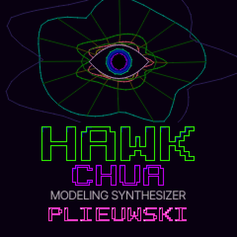

# HAWK CHUA

**A chaotic modelling synthesizer firmware for the M-VAVE FM-1**, by **plieuwski**
([@plieuwski](https://www.instagram.com/plieuwski/)). Its oscillator is **Chua's circuit**, the simplest circuit that
behaves chaotically, driving physical models. It also has an arpeggiator and a phrase sequencer that play together in
time with your gear.

[](https://github.com/Plieuw/hawk-chua/actions/workflows/firmware.yml)
[](https://github.com/Plieuw/hawk-chua/releases/latest)



| | |
| --- | --- |
| **Install** (Chrome or Edge, USB cable) | **https://plieuw.github.io/hawk-chua/** |
| **Play it in the browser**, no FM-1 needed | https://plieuw.github.io/hawk-chua/webapp/try/ |
| **Download** the `.fwsc` | [latest release](https://github.com/Plieuw/hawk-chua/releases/latest) |
| **Manual** (Dutch) | [docs/HANDLEIDING.md](docs/HANDLEIDING.md) · [PDF](docs/HAWK-CHUA-handleiding.pdf) |
| **How the circuit works** (interactive) | [docs/chua.html](https://plieuw.github.io/hawk-chua/chua.html) |

## Sound

- **Oscillators**:
  - **Chua's circuit**, one per voice. CHAOS walks from a pure cycle through period doubling to the double scroll; SHAPE
    and OUTPUT colour it. Notes stay in tune where the circuit is periodic.
  - **30 noise oscillators** after Befaco's Noise Plethora, plus a piano, cluster saws and FM.
- **Physical modelling**: every voice excites its own model. There are 17 of them: Rings-style resonators, strings, and
  waveguides for voice, flute, brass, bow, reed and drum.
- **The rest of the chain**: a low pass gate per voice. After it comes **SHIMMER**: reverbs, instrument bodies, a
  Leslie, tempo delays and a talk box.
- **Movement**: **MOD ENV** gives a per-note envelope on any parameter. **FREE EG** (two of them) records a knob movement and plays it
  back once, as an LFO, or locked to a phrase.

## ARP and SEQ, together

- **ARP**: the AN1x arpeggiator types and MC-303 styles, with a velocity and gate GROOVE.
- **SEQ (KARMA)**: a phrase generator. 46 *Generated Effects* turn the chord you hold into a phrase.
- **Together**: with one playing, press the other's button and it joins. **LOGIC** sets how their hits meet on one
  grid:
  - OR: both play.
  - AND: only where both hit.
  - XOR: they fill each other's gaps.
  - NOR, ALT or S/R for the rest.
  - **NOTE QUANT** keeps both in a key.

## With your sequencer

- **Clock**:
  - **EXTERNAL**: ARP, SEQ, the delays and the looper follow MIDI clock over USB or TRS, measured steadily over a
    quarter note. With **AUTOPLAY**, PLAY on your sequencer starts ARP and SEQ (in C major until you pick notes) and
    STOP stops them.
  - **INTERNAL**: the FM-1 sends its BPM out as MIDI clock over USB.
- **MIDI CC**: 71–74 are the four oscillator knobs, so the chaos can be automated. 1 is the mod wheel (any parameter, the MOD FX's vibrato and ring mod too),
  91/93/94 are the space and FX mix, 7/10/11/64 work as usual, and aftertouch is breath.
- **Notes and sounds**: program change and bank select pick from **512 presets** in four banks. **MULTI** puts a
  second sound on its own channel. What ARP and SEQ play goes out over USB-MIDI.

## Install

1. Open **https://plieuw.github.io/hawk-chua/** in Chrome or Edge.
2. Connect the FM-1 with a USB **data** cable and press **Install**.
3. Keep the cable in until it says **Done**: a few minutes. That is longer than the official firmware, because
   HAWK CHUA is a complete ~600 KB package (the synth, 512 presets, fonts and tables, plus its own update loader) and
   the install goes over MIDI: SysEx pieces of 512 bytes, 7 bits a byte, each one requested and checked by the FM-1.

This works from the official firmware, from Felucca and from other FM-1 firmwares; the same page installs later
versions. From the command line: `python3 tools/fm1_install.py hawk-chua.fwsc` (`pip3 install mido python-rtmidi`).
Back to the official firmware: the same tool with M-VAVE's V15 file. A failed install can always be repaired over
UBOOT with [FM-1-transporter](https://github.com/kurogedelic/FM-1-transporter).

## The code

The whole firmware is compiled as one file: [`firmware/src/felucca.c`](firmware/src/felucca.c) includes the others in
order. Where to look:

| File | What |
| --- | --- |
| [`synth.c`](firmware/src/synth.c) | the voices: Chua's circuit (Q20 fixed point RK2), the low pass gate, the output stage |
| [`noise.c`](firmware/src/noise.c) | the noise oscillators, the piano, the clusters |
| [`resonator.c`](firmware/src/resonator.c), [`waveguide.c`](firmware/src/waveguide.c), [`phys_dsp.c`](firmware/src/phys_dsp.c) | the FX models |
| [`shimmer.c`](firmware/src/shimmer.c) | the reverbs, bodies, delays and the MOUTH |
| [`keys.c`](firmware/src/keys.c), [`arp.c`](firmware/src/arp.c), [`karma.c`](firmware/src/karma.c) | keys and MIDI to notes; the ARP, KARMA and LOGIC (in the audio interrupt) |
| [`feg.c`](firmware/src/feg.c), [`tape.c`](firmware/src/tape.c) | FREE EG; the TAPE looper |
| [`ui.c`](firmware/src/ui.c), [`fx_art.c`](firmware/src/fx_art.c) | pages, knobs, LEDs, the presets, the settings; the FX drawings |
| [`core.h`](firmware/src/core.h) | the shared `sys` state (main loop ↔ audio) and constants |
| [`usb.c`](firmware/src/usb.c), [`midi_uart.c`](firmware/src/midi_uart.c), [`ota.c`](firmware/src/ota.c) | USB, TRS MIDI, the update path (keep it: it is how the next build gets on) |
| [`firmware/hal/`](firmware/hal) | the hardware: key matrix, LEDs, encoders, LCD, I2S, flash, the second core |
| [`tests/`](tests) | host tests, no FM-1 needed; [`web/emu/`](web/emu) the firmware as WebAssembly |
| [`tools/`](tools) | the build, table generators, the installer |

House rules (checked by the build): register access only in `hal/`; fixed point in the audio interrupt, and no 64-bit
divisions (the toolchain has none); the audio interrupt finishes within ~2.9 ms.

## Build and test

```
tools/get_toolchain.sh                 # the JieLi toolchain (once)
git clone --depth 1 --branch AC79NN_SDK_V1.2.1_2023-12-13 \
    https://gitee.com/Jieli-Tech/fw-AC79_AIoT_SDK.git ~/fw-AC79_AIoT_SDK
pip3 install Pillow fonttools mido python-rtmidi
./build.sh                             # -> build/hawk-chua.fwsc
sh tests/run_tests.sh                  # host tests
```

Linux x86-64 runs the toolchain directly, macOS in Docker: see [BUILDING.md](BUILDING.md).

**On GitHub** every push to `main` runs one workflow ([firmware.yml](.github/workflows/firmware.yml)): build → tests →
the browser version → the installer site on GitHub Pages; the `.fwsc` is under the run's *Artifacts*. A release:
*Actions → firmware → Run workflow* with a version `X.Y.Z` (one digit each), or push a tag `vX.Y.Z`. Debugging a
CRASH screen's addresses has its own workflow ([debug.yml](.github/workflows/debug.yml)).

**Your own fork**: fork, then *Settings → Pages → Source: GitHub Actions*; the next push publishes your installer at
`https://<you>.github.io/<repo>/`. Give a fork you release its own USB VID/PID (`firmware/src/usb.c`).

## License

GPL-3.0-only, like [Felucca](https://github.com/hugelton/Felucca) by Leo Kuroshita / Hügelton Instruments, which this is
built on (hardware layer, USB, update path). If you share a build, share its source. See [LICENSE](LICENSE),
[LICENSING.md](LICENSING.md) and [CREDITS.md](CREDITS.md).

You can also try HAWK CHUA in the browser, no flashing needed, in the free community [FM-1 Emulator](https://fm1-emulator.atst.tools/).
